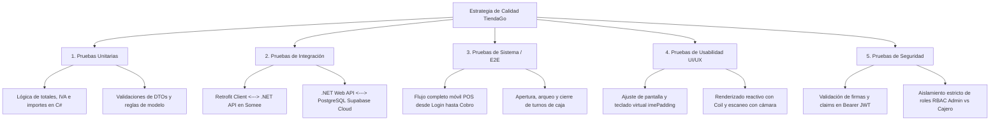

# ESCUELA SUPERIOR FRANCISCANA ESPECIALIZADA – AGAPE
## CARRERA: TÉCNICO EN INGENIERÍA DE DESARROLLO DE SOFTWARE
### MÓDULO: TESTEO DE SOFTWARE

---

# PLANIFICACIÓN DE PRUEBAS A APLICAR AL PROYECTO
## Plan Maestro de Aseguramiento de Calidad de Software: TiendaGo Mobile & Web API

---

### DATOS GENERALES DEL PROYECTO

| Campo | Detalle |
| :--- | :--- |
| **Institución:** | Escuela Superior Franciscana Especializada / AGAPE (ESFE - AGAPE) |
| **Carrera:** | Técnico en Ingeniería de Desarrollo de Software |
| **Módulo:** | Testeo de Software |
| **Proyecto Evaluado:** | **TiendaGo** (Punto de Venta POS Móvil y Gestión de Inventario Express) |
| **Docente:** | Lic. Gerber Alexis Gómez Hidalgo |
| **Ciclo Académico:** | C4-26 (Ciclo 04/2026) |
| **Fecha de Presentación:** | 14 de Octubre de 2026 |
| **Versión del Documento:** | 1.0.0 (Release Candidate) |
| **Norma de Referencia:** | ISO/IEC/IEEE 29119 (Partes 2, 3 y 4) |

### EQUIPO DE TRABAJO Y ASIGNACIÓN (100%)

| Estudiante | Carné / ID | Participación | Rol en el Equipo de Pruebas |
| :--- | :---: | :---: | :--- |
| **Gerardo Antonio Batres Moreno** | BM-2026 | 100% | QA Lead & Test Architect |
| **Elmer Antonio Tesorero Hernández** | TH-2026 | 100% | Backend QA Automation & API Tester |
| **Jason Vladimir Bautista Maravilla** | BM-2026-2 | 100% | Mobile QA Tester & Functional Specialist |
| **Bayron Antonio Díaz Campos** | DC-2026 | 100% | Security Specialist & DevOps / Environment Manager |

---

## ÍNDICE GENERAL

1. [Introducción](#1-introducción)
   - 1.1 [Ficha Técnica de la Aplicación Bajo Prueba (AUT)](#11-ficha-técnica-de-la-aplicación-bajo-prueba-aut)
   - 1.2 [Alcance del Plan de Pruebas](#12-alcance-del-plan-de-pruebas)
     - 1.2.1 [Módulos y Funcionalidades Dentro de Alcance](#121-módulos-y-funcionalidades-dentro-de-alcance)
     - 1.2.2 [Elementos Fuera de Alcance](#122-elementos-fuera-de-alcance)
   - 1.3 [Objetivos de Calidad y KPIs de Evaluación](#13-objetivos-de-calidad-y-kpis-de-evaluación)
   - 1.4 [Roles y Responsabilidades del Equipo de QA](#14-roles-y-responsabilidades-del-equipo-de-qa)
2. [Metodología de Prueba](#2-metodología-de-prueba)
   - 2.1 [Compendio Metodológico (ISO/IEC/IEEE 29119)](#21-compendio-metodológico-isoiecieee-29119)
   - 2.2 [Técnicas de Diseño de Pruebas Aplicadas](#22-técnicas-de-diseño-de-pruebas-aplicadas)
   - 2.3 [Niveles y Tipos de Prueba](#23-niveles-y-tipos-de-prueba)
   - 2.4 [Matriz de Casos de Prueba Esenciales (Test Cases)](#24-matriz-de-casos-de-prueba-esenciales-test-cases)
   - 2.5 [Criterios de Suspensión y Requisitos de Reanudación](#25-criterios-de-suspensión-y-requisitos-de-reanudación)
   - 2.6 [Criterios de Completitud de la Prueba (Sign-off)](#26-criterios-de-completitud-de-la-prueba-sign-off)
3. [Matriz de Trazabilidad de Requisitos (RTM)](#3-matriz-de-trazabilidad-de-requisitos-rtm)
4. [Necesidades de Recursos y Medio Ambiente](#4-necesidades-de-recursos-y-medio-ambiente)
   - 4.1 [Herramientas de Prueba](#41-herramientas-de-prueba)
   - 4.2 [Entorno de Prueba (Hardware, Software y Datos Semilla)](#42-entorno-de-prueba-hardware-software-y-datos-semilla)
   - 4.3 [Dependencias y Gestión de Riesgos del Entorno](#43-dependencias-y-gestión-de-riesgos-del-entorno)
5. [Glosario de Términos y Acrónimos](#5-glosario-de-términos-y-acrónimos)

---

## 1. INTRODUCCIÓN

El presente **Plan Maestro de Pruebas** formaliza el marco integral de aseguramiento de calidad (QA), alcance operativo, criterios de aceptación, asignación de responsabilidades y metodologías de validación técnica para la plataforma **TiendaGo**. 

**TiendaGo** es una solución tecnológica integral de Punto de Venta Móvil (POS) y Administración de Inventario Express diseñada específicamente para optimizar la operativa comercial de pequeños comercios, tiendas de conveniencia y bazares. La arquitectura del sistema está concebida bajo un modelo **Cliente-Servidor desacoplado** compuesto por:
1. **Cliente Móvil Nativo:** Desarrollado sobre la plataforma Android utilizando **Jetpack Compose** y **Kotlin**, enfocado en una experiencia de usuario ergonómica, ágil, táctil y de alta respuesta, con capacidad de lectura de códigos de barras/QR mediante cámara integrada.
2. **Backend Web API RESTful:** Implementado en **ASP.NET Core (.NET 8)** mediante arquitectura de servicios modulares y controladores Minimal APIs, responsable de la seguridad perimetral, autenticación basada en tokens JWT, emisión de reglas de negocio y procesamiento transaccional atómico.
3. **Capa de Persistencia:** Base de datos relacional **PostgreSQL** alojada en la infraestructura Cloud de **Supabase**, estructurada en Tercera Forma Normal (3FN), con soporte para transacciones ACID, Row Level Security (RLS) y sincronización de datos en tiempo real.

El diseño y redacción de este documento rige la validación de la versión **1.0.0 (Release Candidate)** y se fundamenta estrictamente en la familia de estándares internacionales **ISO/IEC/IEEE 29119**:
* **ISO/IEC/IEEE 29119-2 (Procesos de Prueba):** Para estructurar el ciclo formal de planificación, especificación, ejecución, reporte y cierre.
* **ISO/IEC/IEEE 29119-3 (Documentación de Prueba):** Para estructurar formalmente las secciones de este Plan de Pruebas, sus artefactos y matrices.
* **ISO/IEC/IEEE 29119-4 (Técnicas de Prueba):** Para guiar la aplicación de técnicas de caja negra, tales como Análisis de Valores Límite (BVA), Particiones de Equivalencia (EP), Pruebas de Transición de Estados (ST) y Pruebas de Matriz de Acceso Basado en Roles (RBAC).

---

### 1.1 FICHA TÉCNICA DE LA APLICACIÓN BAJO PRUEBA (AUT)

| Parámetro | Especificación Técnica del Proyecto |
| :--- | :--- |
| **Nombre del Sistema:** | TiendaGo: POS Móvil & Inventario Express |
| **Versión Bajo Prueba (AUT):** | Versión 1.0.0 (Release Candidate - RC1) |
| **Arquitectura de Software:** | Cliente-Servidor Desacoplado / Servicios RESTful / N-Capas |
| **Tecnología Cliente Móvil:** | Android Nativo, Kotlin 1.9+, Jetpack Compose, Retrofit 2, OkHttp 4, Coil (imágenes), DataStore Preferences |
| **Tecnología Backend API:** | .NET 8.0, ASP.NET Core Web API / Minimal APIs, Entity Framework Core 8.0, Supabase C# SDK, BCrypt.Net |
| **Seguridad y Tokens:** | JWT (JSON Web Tokens) con algoritmo HMAC-SHA256, Claims de Identidad y Roles |
| **Motor de Base de Datos:** | PostgreSQL 15 alojado en Supabase Cloud (AWS us-west-2 pooler con conexión segura SSL) |
| **Infraestructura de Hosting:** | Servidor Web Somee Hosting (`http://TiendaGO.somee.com/`) y Supabase Managed Cloud |
| **Control de Versiones:** | Git / GitHub (Ramas `main`, `develop`, ramas `feature/*` bajo esquema Git Flow con Pull Requests) |
| **Estándar de Calidad:** | ISO/IEC/IEEE 29119 (Partes 2, 3 y 4) |
| **Base de Datos de Pruebas:** | `TiendaGo_DB_QA` (Instancia de aislamiento con seeders automatizados de roles, usuarios y catálogo) |

---

### 1.2 ALCANCE DEL PLAN DE PRUEBAS

#### 1.2.1 Módulos y Funcionalidades Dentro de Alcance

El plan de pruebas someterá a validación rigurosa los siguientes componentes funcionales y técnicos:

1. **Módulo de Autenticación, Sesión y Seguridad (US-AUTH):**
   - Validación de ingreso mediante correo electrónico y clave con hashing seguro BCrypt.
   - Emisión correcta de Bearer Token JWT conteniendo claims de usuario, expiración y rol asignado.
   - Rechazo controlado de solicitudes con credenciales inválidas o formato de correo incorrecto.
   - Persistencia cifrada del token en almacenamiento local de Android mediante `DataStore Preferences`.
   - Cierre de sesión seguro con invalidación local del token y reseteo absoluto de la pila de navegación (`backstack`) de Jetpack Compose para impedir navegación retroactiva no autorizada.

2. **Módulo de Control de Acceso Basado en Roles (RBAC):**
   - **Rol Administrador:** Acceso irrestricto al panel de control, analítica del dashboard, administración de productos (creación, edición, precios, costos, stock inicial, baja lógica), administración de categorías y monitoreo de turnos de caja.
   - **Rol Cajero:** Restricción estricta de permisos. Ocultamiento visual del botón flotante de adición (`FloatingActionButton`) en catálogo, denegación de acceso a formularios de edición y bloqueo a nivel de API (HTTP 403 Forbidden) en endpoints de mutación administrativa. Acceso restringido exclusivamente a terminal POS, lectura de catálogo y apertura/cierre de su propio turno de caja.

3. **Módulo de Inventario y Catálogo de Productos (US-CAT):**
   - Listado paginado y filtrado por categorías de productos.
   - Búsqueda dinámica en tiempo real por descripción textual y por código SKU.
   - Escaneo de códigos de barras y códigos QR utilizando la cámara del dispositivo móvil mediante integración con bibliotecas de visión por computador.
   - Carga reactiva de imágenes de productos (manejo de URLs absolutas de Supabase Storage y rutas relativas con resolución sobre `BASE_URL`).
   - Alerta visual inmediata mediante badges cromáticos para existencias en estado crítico (`stock_actual <= stock_minimo`, umbral predeterminado de 5 unidades).

4. **Módulo de Control de Turnos de Caja (US-TUR):**
   - Flujo de apertura de caja con validación de monto base inicial en efectivo.
   - Asociación biunívoca obligatoria entre el cajero activo, su turno abierto y las ventas emitidas.
   - Cierre de turno con arqueo ciego, registro de monto declarado y cálculo automático de diferencia de cuadre (faltante/sobrante/exacto).
   - Impedimento estricto de procesar ventas si el cajero no cuenta con un turno de caja en estado "Abierto".

5. **Módulo de Terminal de Punto de Venta (POS) y Transaccionalidad (US-POS):**
   - Selección ágil y adición ergonómica de productos al carrito con selectores de incremento/decremento (+/-) diseñados para operar en menos de 4 toques.
   - Cálculo automático y en tiempo real de subtotales, desglose de impuestos (IVA 13%) y total a cancelar.
   - Modal de confirmación de cobro con soporte a múltiples métodos de pago (Efectivo y Transferencia Digital QR).
   - Atajos numéricos de billetes táctiles ($10, $20, $50) para agilizar el ingreso de efectivo y cálculo automático del cambio a entregar.
   - **Garantía Transaccional ACID:** Ejecución de la venta y descuento simultáneo de stock dentro de un bloque transaccional atómico en PostgreSQL. En caso de concurrencia o stock insuficiente, la venta debe abortarse inmediatamente con Rollback completo.

6. **Módulo de Dashboard y Métricas Comerciales (US-DASH):**
   - Obtención de resumen financiero del día: monto bruto facturado, cantidad de transacciones ejecutadas y conteo de productos con stock agotado o en nivel crítico.

7. **Pruebas de Usabilidad, Adaptabilidad y UI/UX Móvil:**
   - Manejo adecuado de insets de teclado virtual del sistema operativo (`adjustResize` / `imePadding`) para garantizar que el teclado en pantalla no solape los campos de texto en formularios de producto o montos de cobro.
   - Comportamiento de interfaces ante cambios de orientación de pantalla y estados de red inestables.

---

#### 1.2.2 Elementos Fuera de Alcance

Quedan formalmente excluidos del ciclo de pruebas de la presente versión:
* Integración con hardware de lectura de tarjetas bancarias por contacto físico, banda magnética o chip EMV.
* Operación en modalidad 100% desconectada (Offline First con sincronización bidireccional diferida); la plataforma exige conectividad a Internet para garantizar la atomicidad del inventario centralizado.
* Compatibilidad nativa con sistemas operativos Apple iOS.
* Pruebas de estrés volumétrico extremo y resistencia ante ataques distribuidos de denegación de servicio (DDoS) dirigidos hacia la infraestructura compartida gratuita de Somee.
* Conexión por Bluetooth a impresoras térmicas de tickets ESC/POS (se verifica exclusivamente la generación del número de ticket correlativo y la confirmación visual de comprobante digital).

---

### 1.3 OBJETIVOS DE CALIDAD Y KPIS DE EVALUACIÓN

La meta primordial del plan es certificar con evidencia objetiva, auditable y repetible que **TiendaGo** satisface los estándares de confiabilidad, integridad transaccional y seguridad exigidos para su puesta en marcha.

Los objetivos se medirán y gobernarán mediante la siguiente matriz de Indicadores Clave de Desempeño (**KPIs**):

| Indicador (KPI) | Meta Establecida | Criterio de Medición y Observación |
| :--- | :---: | :--- |
| **Cobertura de Ejecución de Pruebas** | **100%** | Todos los casos de prueba diseñados en la Suite Oficial deben ejecutarse y documentarse con evidencia gráfica. |
| **Tasa de Aprobación General (Pass Rate)** | **$\ge$ 95%** | Al menos el 95% de los casos ejecutados deben resultar satisfactorios (Pass). El 5% restante solo se admite en defectos menores (Low/Medium) que posean workaround documentado. |
| **Aprobación en Casos Críticos (Blocker/Critical)** | **100%** | Obligatorio e innegociable. Aplica a: Prevención de venta sin stock (ACID), cálculo exacto de totales/cambio, autenticación JWT y aislamiento de privilegios RBAC. |
| **Defectos Críticos Abiertos al Cierre** | **0** | No se concederá el aval de liberación si existe algún defecto de severidad Crítica o Alta sin resolver en el repositorio. |
| **Vulnerabilidades de Control de Acceso (RBAC)** | **0** | Cero tolerancia a escalamiento de privilegios o ejecución de endpoints administrativos por usuarios con rol Cajero. |
| **Trazabilidad de Requisitos (RTM)** | **100%** | El 100% de las Historias de Usuario y Requerimientos Funcionales deben contar con al menos un caso de prueba vinculado. |
| **Estabilidad Móvil (Crashes / ANRs)** | **0%** | Cero eventos de cierre forzado de aplicación (Crash por NullPointerException o desbordamiento de memoria OOM) y cero congelamientos de interfaz (ANR). |

---

### 1.4 ROLES Y RESPONSABILIDADES DEL EQUIPO DE QA

El equipo de aseguramiento de calidad opera bajo un modelo colaborativo, ágil y multidisciplinario, utilizando GitHub para la gestión de código y seguimiento de incidentes. Las funciones se distribuyen formalmente de la siguiente manera:

| Integrante | Rol Oficial | Responsabilidades Primordiales | Áreas de Especialidad a Cargo |
| :--- | :--- | :--- | :--- |
| **Gerardo Antonio Batres Moreno** | **QA Lead & Test Architect** | - Define la estrategia integral de pruebas bajo la norma ISO/IEC/IEEE 29119. - Administra el repositorio en GitHub, define políticas de ramas (`Branch Protection`) y aprueba los Pull Requests. - Supervisa la Matriz de Trazabilidad (RTM) y emite el dictamen final de calidad (*Sign-off*). | Planificación global, gobernanza de calidad, arquitectura de pruebas y sign-off del release. |
| **Elmer Antonio Tesorero Hernández** | **Backend QA Automation & API Tester** | - Diseña y ejecuta suites de pruebas de integración sobre la API REST (.NET 8) mediante Postman/Thunder Client. - Valida la integridad referencial y el comportamiento transaccional ACID en PostgreSQL. - Audita códigos de estado HTTP, payloads JSON, tokens Bearer JWT y tiempos de respuesta del servidor Somee. | API RESTful, persistencia PostgreSQL, concurrencia de inventario y transaccionalidad de ventas. |
| **Jason Vladimir Bautista Maravilla** | **Mobile QA Tester & Functional Specialist** | - Diseña y ejecuta casos de prueba de caja negra (E2E) en dispositivos móviles Android reales y emuladores. - Evalúa flujos de usuario en Jetpack Compose: Login, Catálogo, Escáner de código de barras, Carrito POS y Cuadre de Caja. - Audita aspectos de usabilidad táctil, layout responsivo y comportamiento del teclado virtual (`imePadding`). | Cliente Móvil Android, flujos E2E, interfaz gráfica en Compose, usabilidad y escaneo óptico. |
| **Bayron Antonio Díaz Campos** | **Security Specialist & DevOps / Environment Manager** | - Diseña y ejecuta pruebas de penetración y control de acceso RBAC (matriz de permisos Admin vs Cajero). - Garantiza la disponibilidad, aislamiento y limpieza de la base de datos de pruebas mediante scripts de seeders. - Gestiona la generación y firma de paquetes APK (Debug/Release) en Android Studio y monitorea la estabilidad del backend en Somee. | Seguridad perimetral, RBAC, gestión de datos semilla, compilación de APKs y entornos de prueba. |

---

## 2. METODOLOGÍA DE PRUEBA

### 2.1 COMPENDIO METODOLÓGICO (ISO/IEC/IEEE 29119)

El proceso de pruebas se rige bajo el estándar **ISO/IEC/IEEE 29119-2 (Procesos de Prueba)**, estructurado en cuatro fases dinámicas iterativas:
1. **Planificación y Diseño:** Análisis de requerimientos funcionales, modelado de riesgos de software, definición de casos de prueba y preparación de matrices de trazabilidad.
2. **Implementación y Configuración:** Preparación de datos sintéticos semilla en Supabase, configuración de colecciones de Postman, parametrización de variables de entorno y compilación de APKs homologadas.
3. **Ejecución de Pruebas:** Ejecución sistemática de pruebas unitarias, de integración sobre la API, funcionales en dispositivo móvil y de seguridad RBAC.
4. **Gestión de Incidentes y Cierre:** Registro pormenorizado de bugs encontrados (Bug Reports con pasos de reproducción, severidad y capturas), verificación de fixes mediante pruebas de regresión y emisión del Test Summary Report.

---

### 2.2 TÉCNICAS DE DISEÑO DE PRUEBAS APLICADAS

De acuerdo con **ISO/IEC/IEEE 29119-4 (Técnicas de Prueba)**, se emplean métodos formales de caja negra y pruebas basadas en especificación:

1. **Partición de Equivalencia (Equivalence Partitioning - EP):**
   - Aplicada a campos de entrada numéricos y de autenticación:
     * *Cantidades de venta:* Clases válidas ($[1, \text{Stock}]$), Clases inválidas ($\le 0$, $> \text{Stock}$, alfanuméricos).
     * *Montos recibidos de pago:* Clase válida ($\ge \text{Total Venta}$), Clase inválida ($< \text{Total Venta}$).
     * *Credenciales:* Clases válidas (correo registrado + clave correcta), Clases inválidas (correo no registrado, clave errónea, cadenas vacías).

2. **Análisis de Valores Límite (Boundary Value Analysis - BVA):**
   - Evaluación exhaustiva en las fronteras críticas de la lógica de negocio:
     * *Stock de productos:* Evaluación con existencia en 0 (agotado), existencia en 1 (última unidad disponible), existencia en 5 (umbral límite de alerta crítica) y existencia en 6 (normal).
     * *Precios y costos:* Evaluación en límite mínimo permitido ($0.01) y valores cero o negativos (rechazados por validación).
     * *Monto recibido:* Evaluación con pago exacto ($\text{Monto} = \text{Total}$, cambio $0.00) y pago con centavo de diferencia ($\text{Monto} = \text{Total} - 0.01$, rechazado).

3. **Pruebas de Transición de Estados (State Transition Testing - ST):**
   - *Ciclo de Sesión del Usuario:* Anónimo $\rightarrow$ Autenticado (con Token) $\rightarrow$ Sesión Expirada / Logout $\rightarrow$ Pila de Navegación Limpia.
   - *Ciclo del Turno de Caja:* Sin Turno $\rightarrow$ Apertura (Monto Base) $\rightarrow$ Turno Abierto (Ventas Habilitadas) $\rightarrow$ Arqueo Ciego $\rightarrow$ Turno Cerrado (Bloqueo de Ventas).
   - *Ciclo de Existencias del Producto:* Disponible $\rightarrow$ Stock Crítico $\rightarrow$ Agotado $\rightarrow$ Deshabilitado en Terminal POS.

4. **Matriz de Pruebas de Roles (RBAC Testing Matrix):**
   - Validación cruzada de la totalidad de vistas y endpoints REST contrastando las credenciales de un Administrador frente a las de un Cajero, certificando que cualquier intento de invocación de endpoints administrativos con credenciales de cajero resulte en `403 Forbidden`.

5. **Pruebas de Transaccionalidad Concurrente (ACID Verification):**
   - Verificación de la atomicidad del método `RegistrarVentaAsync`: simulación de dos solicitudes concurrentes intentando comprar la última unidad en existencia para constatar que solo una se confirme y la segunda sea declinada sin corromper el stock en PostgreSQL.

---

### 2.3 NIVELES Y TIPOS DE PRUEBA

* **Pruebas Unitarias (Nivel Código / Servicios):** Verificación matemática del cálculo de subtotales, IVA (13%), atajos de cambio en efectivo, validadores de cadenas SKU y mapeo bidireccional de DTOs con AutoMapper en .NET 8.
* **Pruebas de Integración (Capa de Red y Datos):** Verificación de contratos JSON, códigos de estado HTTP (200, 201, 204, 400, 401, 403, 404, 409), serialización de fechas UTC y consultas sobre PostgreSQL en Supabase.
* **Pruebas de Sistema (End-to-End):** Pruebas de flujos completos en dispositivos móviles físicos: desde el arranque de la app, autenticación del cajero, apertura del turno, escaneo de productos, venta, decremento de inventario y cierre de turno.
* **Pruebas de Usabilidad y Rendimiento Móvil:** Evaluación de ergonomía táctil en pantalla chica, consumo eficiente de memoria al renderizar imágenes con la biblioteca Coil y prevención de cierres forzados ante rotación de pantalla o apertura de teclado.

---

### 2.4 MATRIZ DE CASOS DE PRUEBA ESENCIALES (TEST CASES)

A continuación se presentan los casos de prueba nucleares diseñados para certificar los módulos más críticos del sistema TiendaGo:

| ID Caso | Módulo / Requisito | Nombre del Caso de Prueba | Precondiciones | Datos de Entrada / Pasos | Resultado Esperado | Prioridad |
| :---: | :--- | :--- | :--- | :--- | :--- | :---: |
| **TC-01** | Autenticación (RF01) | Inicio de sesión exitoso y recepción de JWT | Usuario registrado y activo en base de datos. | Correo: `admin@tiendago.com` Clave: `Admin123*` Pulsar botón "Iniciar Sesión". | HTTP 200 OK. La API emite token JWT con claims válidos. La app almacena el token en DataStore y navega al Dashboard. | **Crítica** |
| **TC-02** | Autenticación (RF01) | Rechazo de acceso con contraseña incorrecta | Usuario existe en el sistema. | Correo: `admin@tiendago.com` Clave: `ClaveInvalida999` Pulsar botón "Iniciar Sesión". | HTTP 401 Unauthorized. La app muestra notificación emergente de error indicando credenciales inválidas. No se almacena ningún token. | **Alta** |
| **TC-03** | Seguridad / RBAC (RF01) | Restricción de permisos y vistas a rol Cajero | Usuario con rol Cajero autenticado con éxito. | Iniciar sesión como Cajero e ingresar al Catálogo de Productos. Intentar invocar POST `/api/productos`. | En la app móvil, el botón flotante (+) para crear productos está oculto. Si se invoca el endpoint vía Postman con el token de cajero, el servidor responde HTTP 403 Forbidden. | **Bloqueante** |
| **TC-04** | Catálogo (RF03) | Búsqueda dinámica y escaneo óptico por SKU | Producto con código SKU `75010001` registrado y activo. | Abrir Catálogo. Activar escáner de cámara o escribir `75010001` en el campo de búsqueda. | El producto es localizado instantáneamente mostrando imagen, nombre, precio de venta ($1.25) y stock actual. | **Media** |
| **TC-05** | Catálogo (RF03) | Visualización de badge de alerta de stock crítico | Producto con existencia igual a 3 unidades (menor al mínimo de 5). | Ingresar al Catálogo de Productos y ubicar el ítem. | La tarjeta del producto muestra un badge visual de color rojo/ámbar indicando "Stock Crítico: 3 unidades restantes". | **Media** |
| **TC-06** | Turnos de Caja (RF06) | Apertura exitosa de turno con monto base | Cajero no tiene ningún turno abierto en curso. | Ingresar monto base inicial: `$50.00`. Pulsar "Abrir Turno de Caja". | HTTP 201 Created. Se inserta registro en tabla `turnos_caja` con estado "Abierto". Se habilitan las operaciones de venta en la terminal POS. | **Alta** |
| **TC-07** | Punto de Venta (RF05) | Venta exitosa en efectivo y cálculo exacto de cambio | Turno de caja abierto. Producto con 10 unidades disponibles ($2.50 c/u). | Agregar 2 unidades al carrito (Total: $5.00). Seleccionar "Efectivo", pulsar atajo de billete `$10.00` y confirmar venta. | HTTP 201 Created. La app muestra venta completada con Cambio a Entregar: `$5.00` y genera ticket correlativo (ej. `TCK-10542389`). | **Bloqueante** |
| **TC-08** | Integridad ACID (RF05) | Bloqueo de venta ante stock insuficiente | Producto con solo 1 unidad disponible en inventario. | Agregar 2 unidades al carrito e intentar procesar el cobro. | HTTP 400 Bad Request / 409 Conflict con mensaje: "Stock insuficiente para el producto. Disponible: 1, Solicitado: 2". La transacción hace Rollback y no se cobra nada. | **Bloqueante** |
| **TC-09** | Persistencia (RF04/RF05) | Verificación de decremento físico en PostgreSQL | Producto con stock inicial de 20 unidades en base de datos. | Procesar una venta confirmada de 4 unidades de dicho producto. | Consultar la tabla `productos` en PostgreSQL (Supabase): el campo `stock_actual` se actualizó atómicamente a 16 unidades. | **Crítica** |
| **TC-10** | Turnos de Caja (RF06) | Cierre de turno, arqueo ciego y cuadre de caja | Turno abierto con ventas realizadas durante la jornada. | Ingresar a Cierre de Turno. Ingresar monto físico contado en gaveta. Pulsar "Finalizar Turno". | HTTP 200 OK. El sistema calcula la diferencia (Monto Declarado vs Total Esperado), actualiza el turno a "Cerrado" y bloquea nuevas ventas. | **Alta** |

---

### 2.5 CRITERIOS DE SUSPENSIÓN Y REQUISITOS DE REANUDACIÓN

Con el fin de salvaguardar la eficiencia y no malgastar recursos de prueba en entornos inestables, se establecen los siguientes criterios formales:

#### Criterios de Suspensión
Las actividades de prueba se detendrán de inmediato ante cualquiera de las siguientes eventualidades:
1. **Caída total o intermitencia severa del backend:** Errores recurrentes HTTP 500 / 502 en el servidor Somee (`http://TiendaGO.somee.com/`).
2. **Inaccesibilidad del motor de base de datos:** Caída del pooler o bloqueo de credenciales en Supabase PostgreSQL.
3. **Falla de compilación o instalación del paquete móvil:** Imposibilidad de generar o instalar el archivo APK en los dispositivos de prueba debido a errores de empaquetado, dependencias rotas o conflictos de firma criptográfica.
4. **Bloqueo absoluto de autenticación:** Falla en el endpoint `/api/auth/login` que impida la generación u homologación de tokens JWT tanto para Administradores como para Cajeros.

#### Requisitos de Reanudación
Las pruebas únicamente se reanudarán cuando se verifiquen fehacientemente las siguientes condiciones:
1. **Verificación de conectividad y salud del servicio (Health Check):** Confirmación de respuesta HTTP 200 OK en la ruta base de la API y verificación de conexión activa con PostgreSQL.
2. **Entrega de nueva compilación de APK saneada:** Suministro de un nuevo artefacto APK con control de versión incrementado y notas de cambio (*Changelog*) emitidas por el equipo de desarrollo.
3. **Restauración y saneamiento de datos de prueba:** Ejecución de scripts SQL de limpieza y re-ejecución del seeder (`SeedAdmin.sql`) para retornar la base de datos a un estado inicial controlado y consistente.

---

### 2.6 CRITERIOS DE COMPLETITUD DE LA PRUEBA (SIGN-OFF)

La fase de pruebas de TiendaGo se declarará formalmente concluida y se otorgará el aval técnico de pase a producción (*Sign-off*) cuando se satisfagan la totalidad de las siguientes condiciones:

| Criterio | Condición Obligatoria de Cumplimiento | Estado Actual / Validación |
| :--- | :--- | :--- |
| **Ejecución Total de Casos** | 100% de los casos de prueba definidos en la Suite Oficial ejecutados y con evidencias archivadas. | En proceso conforme al cronograma de ejecución del Sprint de QA. |
| **Aprobación de Casos Críticos** | 100% de aprobación en casos de severidad Bloqueante y Crítica (TC-01, TC-03, TC-07, TC-08 y TC-09). | Mandatorio: No se tolera ninguna excepción en transaccionalidad ni seguridad. |
| **Tasa de Aprobación Global** | Mínimo 95% de aprobación en el universo total de pruebas ejecutadas. | Los casos fallidos no deben comprometer datos financieros ni inventario. |
| **Defectos Bloqueantes / Críticos** | Cero (0) defectos de severidad Blocker o Critical abiertos en el repositorio de incidentes. | Obligatorio para proceder a la entrega formal. |
| **Aislamiento de Privilegios (RBAC)** | Cero vulnerabilidades que permitan a un usuario Cajero modificar precios o realizar tareas de Administrador. | Verificado con matriz de seguridad y auditoría de endpoints. |
| **Trazabilidad de Requisitos (RTM)** | 100% de cobertura de historias de usuario y requerimientos del sistema con relación de prueba asociada. | Cumplido integralmente en la Matriz de Trazabilidad. |
| **Estabilidad de Código Fuente** | Código fusionado en la rama `main` de GitHub sin conflictos, probado contra el APK de producción. | Verificado mediante Pull Requests aprobados por el QA Lead. |
| **Documentación de Entrega** | Informe de Resumen de Pruebas (*Test Summary Report*) finalizado, firmado y avalado por el QA Lead. | Aprobado formalmente por Gerardo Antonio Batres Moreno. |

---

## 3. MATRIZ DE TRAZABILIDAD DE REQUISITOS (RTM)

La Matriz de Trazabilidad garantiza que no existan requerimientos de software sin cobertura de pruebas, vinculando los requerimientos de la especificación técnica de TiendaGo con sus casos de validación:

| ID Requerimiento | Descripción del Requerimiento Funcional | Caso de Prueba Asociado | Nivel de Prueba | Severidad Asociada | Técnica de Diseño Aplicada |
| :---: | :--- | :---: | :---: | :---: | :--- |
| **RF01** | Control de Acceso, Autenticación JWT y Roles de Usuario | TC-01, TC-02, TC-03 | Integración / Seguridad | Bloqueante | Partición de Equivalencia / Matriz RBAC |
| **RF02** | Dashboard con Balance Diario y Métricas en Tiempo Real | TC-05 | Sistema / UI | Media | Pruebas de Transición de Estados |
| **RF03** | Catálogo de Productos con Búsqueda, Filtro y Alerta Crítica | TC-04, TC-05 | Sistema / Funcional | Alta | Valores Límite (Stock < 5) / Búsqueda |
| **RF04** | Gestión de Productos (Creación, Modificación, Baja, SKU) | TC-03, TC-04, TC-09 | Integración / API | Crítica | Partición de Equivalencia / Valores Límite |
| **RF05** | Terminal POS, Venta Transaccional ACID y Descuento de Stock | TC-07, TC-08, TC-09 | E2E / Transaccional | Bloqueante | Valores Límite / Pruebas de Concurrencia |
| **RF06** | Control de Turnos de Caja (Apertura, Arqueo Ciego y Cuadre) | TC-06, TC-10 | Sistema / Transaccional | Alta | Transición de Estados (Abierto/Cerrado) |
| **RF07** | Historial Cronológico de Tickets y Detalle de Ventas | TC-07 | Sistema / Funcional | Media | Pruebas de Integración de Base de Datos |
| **RNF01** | Seguridad: Protección de Endpoints con Bearer Token JWT | TC-01, TC-03 | Seguridad / API | Bloqueante | Análisis de Tokens y Claims |
| **RNF02** | Atomicidad e Integridad de Inventario (Propiedades ACID) | TC-08, TC-09 | Persistencia / Backend | Bloqueante | Verificación de Transacciones SQL |
| **RNF03** | Usabilidad Móvil: Ergonomía Táctil y Manejo de Teclado IME | TC-07 | UI / UX Móvil | Media | Inspección Visual de Insets de Pantalla |

---

## 4. NECESIDADES DE RECURSOS Y MEDIO AMBIENTE

### 4.1 HERRAMIENTAS DE PRUEBA

El equipo de QA hace uso de un conjunto homologado de herramientas tecnológicas de primer nivel:

| Categoría | Herramienta Homologada | Versión | Propósito y Uso Específico en el Proyecto TiendaGo |
| :--- | :--- | :---: | :--- |
| **Gestión de Versiones y Ciclo de Vida (ALM)** | **Git / GitHub** | Última estable | Repositorio central, control de versiones bajo Git Flow, ramas de funcionalidad (`feature/*`), Pull Requests con revisión obligatoria y seguimiento de incidentes. |
| **Desarrollo y Diagnóstico Móvil** | **Android Studio (Ladybug / Iguana)** | 2024.1+ | Monitoreo en vivo de trazas con **Logcat**, depuración de memoria, análisis de red y uso de **Layout Inspector** para auditar componentes de Jetpack Compose. |
| **Pruebas de API y Contratos REST** | **Postman / Thunder Client** | v11+ | Colección automatizada de endpoints REST (.NET 8), validación de códigos de estado HTTP, inyección de tokens JWT en headers de autorización y validación de payloads JSON. |
| **Persistencia y Motor de Datos** | **Supabase Dashboard & DBeaver** | Cloud / v24+ | Inspección directa de tablas relacionales en PostgreSQL, ejecución de consultas SQL de verificación de stock y gestión de autenticación (`auth.users`). |
| **Proyección y Captura de Evidencias** | **Scrcpy** | v2.4+ | Proyección en tiempo real y captura en alta definición de la pantalla de dispositivos Android físicos para documentar la evidencia auditable de los casos de prueba. |
| **Frameworks de Automatización** | **xUnit / NUnit & Compose UI Test** | .NET 8 / AndroidX | Ejecución de pruebas unitarias sobre servicios de cálculo en el backend y pruebas automatizadas sobre componentes de interfaz en Jetpack Compose. |

---

### 4.2 ENTORNO DE PRUEBA (HARDWARE, SOFTWARE Y DATOS SEMILLA)

La infraestructura del laboratorio de pruebas se encuentra aislada de los entornos productivos y se compone de:

| Componente | Requisito / Especificación Técnica del Entorno |
| :--- | :--- |
| **Plataforma Cliente Móvil (Física):** | Smartphone Samsung Galaxy (SM-A556E) con Android 14 / One UI 6, y dispositivo Xiaomi Redmi Note con Android 13. |
| **Plataforma Cliente Móvil (Virtual):** | Emulador Android Studio Virtual Device (AVD): Google Pixel 8 Pro configurado con imagen de sistema Android 14 (API Level 34). |
| **Servidor de Alojamiento Backend:** | Servidor Web Somee Hosting en Windows Server (`http://TiendaGO.somee.com/`), ASP.NET Core 8.0 Runtime. |
| **Servidor de Base de Datos:** | PostgreSQL 15 en la nube alojado en Supabase (AWS us-west-2 pooler con SSL Mode Require). |
| **Datos Semilla (Seeders):** | - 2 Roles del sistema: `Administrador` (ID: 1) y `Cajero` (ID: 2). - 2 Usuarios sintéticos de prueba: Administrador (`admin@tiendago.com`) y Cajero (`cajero@tiendago.com`). - Catálogo sintético con 20 productos de prueba en 4 categorías representativas (Bebidas, Snacks, Lácteos, Granos Básicos) con SKUs normalizados y stock controlado (incluyendo ítems con stock crítico y agotados). |
| **Estación de Trabajo QA:** | PC con Procesador x64 de 6 núcleos (3.4 GHz o superior), 16 GB de memoria RAM, almacenamiento SSD NVMe y conexión a Internet de banda ancha estable. |

---

### 4.3 DEPENDENCIAS Y GESTIÓN DE RIESGOS DEL ENTORNO

Se identifican los siguientes riesgos operativos de infraestructura que podrían impactar la ejecución de las pruebas, junto con sus planes de contingencia y mitigación:

| Riesgo Identificado | Probabilidad | Impacto | Estrategia de Mitigación y Contingencia |
| :--- | :---: | :---: | :--- |
| **Indisponibilidad del hosting gratuito Somee (Timeouts HTTP 500 / 502)** | Media | Alto | Configuración de servidor de respaldo local mediante Kestrel / IIS Express en red local para pruebas de contingencia si el servidor externo sufre caídas temporales. |
| **Corrupción o inconsistencia de datos por pruebas destructivas anteriores** | Media | Alto | Uso exclusivo de una base de datos de pruebas (`TiendaGo_DB_QA`) aislada de producción, respaldada por un script SQL de re-inicialización rápida ejecutado antes de cada ciclo de prueba. |
| **Inconsistencia de permisos por desactualización de claims en el token JWT** | Baja | Medio | Configuración de tokens con tiempo de expiración corto para pruebas y verificación programática de invalidación al cambiar de rol en el sistema. |
| **Bloqueo del teclado virtual sobre componentes de entrada en pantallas pequeñas** | Alta | Medio | Implementación y verificación estricta de modificadores `imePadding()` y `rememberScrollState()` en los contenedores de Compose dentro de los formularios móviles. |
| **Fallas en la resolución de URLs de imágenes estáticas en el cliente móvil** | Media | Bajo | Implementación de fallback en la biblioteca Coil: si la imagen de Supabase Storage no está disponible, la app renderiza un icono vectorial de marcador de posición (*placeholder*) sin generar crashes. |

---

## 5. GLOSARIO DE TÉRMINOS Y ACRÓNIMOS

Para asegurar una interpretación unívoca entre todos los participantes y evaluadores del proyecto, se define la siguiente terminología técnica estandarizada:

| Término / Acrónimo | Definición Formal en el Contexto del Proyecto |
| :--- | :--- |
| **ACID** | *(Atomicity, Consistency, Isolation, Durability)*: Conjunto de cuatro propiedades fundamentales de las transacciones de bases de datos que garantizan que las operaciones de cobro y descuento de stock se ejecuten de forma atómica y fiable. |
| **ALM** | *(Application Lifecycle Management)*: Gestión integral del ciclo de vida de una aplicación informática, abarcando gobernanza, desarrollo, control de versiones y aseguramiento de la calidad. |
| **ANR** | *(Application Not Responding)*: Diálogo de error del sistema operativo Android que se dispara cuando la aplicación congela el hilo principal de la interfaz por más de 5 segundos. |
| **API** | *(Application Programming Interface)*: Interfaz de programación basada en estándares REST que posibilita la comunicación e intercambio de datos entre la app móvil y el servidor backend. |
| **APK** | *(Android Package Kit)*: Formato de archivo binario y ejecutable utilizado para la distribución e instalación de aplicaciones en el sistema operativo Android. |
| **AUT** | *(Application Under Test)*: Aplicación bajo prueba; refiere específicamente a la plataforma de software TiendaGo en su versión evaluada. |
| **BVA** | *(Boundary Value Analysis)*: Técnica de diseño de pruebas de caja negra centrada en evaluar los valores límite o extremos de las clases de equivalencia (por ejemplo: stock 0, 1 y límite de stock mínimo). |
| **Coil** | Biblioteca de carga y renderizado reactivo de imágenes desarrollada para Android y respaldada por corrutinas de Kotlin, optimizada para Jetpack Compose. |
| **DataStore** | Solución moderna de almacenamiento local de pares clave-valor en Android, utilizada para guardar de forma segura y no volátil el token JWT. |
| **DTO** | *(Data Transfer Object)*: Patrón de diseño de objetos simples sin lógica de negocio, empleado para encapsular y transmitir datos entre el cliente móvil y la API REST. |
| **EP** | *(Equivalence Partitioning)*: Técnica de prueba de caja negra que divide los dominios de entrada en particiones equivalentes de donde se extraen valores representativos para las pruebas. |
| **IME** | *(Input Method Editor)*: Componente del sistema operativo Android responsable del despliegue del teclado virtual en pantalla para el ingreso de texto por parte del usuario. |
| **ISO/IEC/IEEE 29119** | Conjunto de normas internacionales reconocidas formalmente por ISO e IEEE que rigen el vocabulario, procesos, documentación y técnicas de prueba de software. |
| **Jetpack Compose** | Kit de herramientas moderno y declarativo desarrollado por Google para la construcción de interfaces de usuario nativas en Android. |
| **JWT** | *(JSON Web Token)*: Estándar abierto (RFC 7519) que define un método compacto y autónomo para transmitir información de identidad firmada digitalmente entre partes. |
| **POS** | *(Point of Sale)*: Terminal de Punto de Venta; sistema informático transaccional orientado a la venta al menudeo, cobro de mercancías y emisión de tickets. |
| **RBAC** | *(Role-Based Access Control)*: Modelo de seguridad y autorización que restringe el acceso a módulos, pantallas y endpoints en función del rol asignado al usuario (Administrador vs Cajero). |
| **RLS** | *(Row Level Security)*: Mecanismo de seguridad a nivel de motor de base de datos en PostgreSQL que restringe la visibilidad y modificación de filas según políticas de seguridad. |
| **RTM** | *(Requirements Traceability Matrix)*: Matriz de trazabilidad que correlaciona bidireccionalmente los requerimientos del cliente con los casos de prueba diseñados para su verificación. |
| **Sign-off** | Aprobación técnica y formal emitida por el Líder de QA que certifica que el software ha alcanzado los niveles de calidad requeridos para su entrega o pase a producción. |
| **Supabase** | Plataforma Backend-as-a-Service (BaaS) de código abierto basada en PostgreSQL, empleada en el proyecto para la persistencia en la nube y gestión de base de datos. |

---

### APROBACIÓN Y DICTAMEN DE ASEGURAMIENTO DE CALIDAD

El presente **Plan Maestro de Pruebas** ha sido revisado, estructurado y avalado de conformidad con los lineamientos académicos de la **Escuela Superior Franciscana Especializada / AGAPE** y los estándares internacionales **ISO/IEC/IEEE 29119**:

* **Preparado y Diseñado por:** Gerardo Antonio Batres Moreno — *QA Lead & Test Architect*
* **Aprobado para Ejecución por:** Equipo de Aseguramiento de Calidad TiendaGo (Gerardo Batres, Elmer Tesorero, Jason Bautista, Bayron Díaz)
* **Fecha de Emisión Oficial:** 14 de Octubre de 2026
* **Ciclo:** C4-26 (Testeo de Software)
