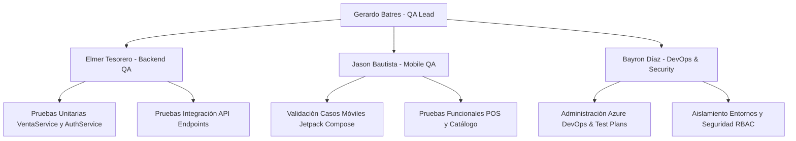

# ESCUELA SUPERIOR FRANCISCANA ESPECIALIZADA – AGAPE
## CARRERA: TÉCNICO EN INGENIERÍA DE DESARROLLO DE SOFTWARE
### MÓDULO: TESTEO DE SOFTWARE (CICLO C4-26)

---

# INFORME TÉCNICO DE DISEÑO Y EJECUCIÓN DE CASOS DE PRUEBA
## Sistema Punto de Venta POS Móvil y Gestión de Inventario Express: TiendaGo

---

### DATOS GENERALES DEL PROYECTO

| Campo | Detalle Institucional y Académico |
| :--- | :--- |
| **Institución Educativa:** | Escuela Superior Franciscana Especializada / AGAPE (ESFE - AGAPE) |
| **Carrera:** | Técnico en Ingeniería de Desarrollo de Software |
| **Módulo Formativo:** | Testeo de Software |
| **Proyecto Evaluado:** | **TiendaGo** (POS Móvil Android & Backend Web API RESTful) |
| **Docente Evaluador:** | Lic. Gerber Alexis Gómez Hidalgo |
| **Ciclo Académico:** | C4-26 (Ciclo 04 / 2026) |
| **Fecha de Presentación:** | Octubre de 2026 |
| **Grupo de Trabajo:** | **Grupo N° 06** |
| **Repositorio Oficial de GitHub:** | [https://github.com/gerardo-ops/TiendaGo.git](https://github.com/gerardo-ops/TiendaGo.git) |
| **Entorno de Gestión (ALM):** | Azure DevOps (`https://dev.azure.com/gerardobatres06/TiendaGo`) |

---

### INTEGRANTES DEL EQUIPO DE TRABAJO (100% PARTICIPACIÓN)

| N° | Nombre Completo del Estudiante | Carné / ID | Rol Asignado en QA | Participación |
| :-: | :--- | :---: | :--- | :---: |
| 1 | **Gerardo Antonio Batres Moreno** | BM-2026 | QA Lead & Test Architect | 100% |
| 2 | **Elmer Antonio Tesorero Hernández** | TH-2026 | Backend QA Automation & API Tester | 100% |
| 3 | **Jason Vladimir Bautista Maravilla** | BM-2026-2 | Mobile QA Tester & Functional Specialist | 100% |
| 4 | **Bayron Antonio Díaz Campos** | DC-2026 | Security Specialist & DevOps / Environment Manager | 100% |

---

## ÍNDICE GENERAL

1. [Introducción y Objetivos](#1-introducción-y-objetivos)
2. [Organización y Distribución del Equipo de Trabajo](#2-organización-y-distribución-del-equipo-de-trabajo)
   - 2.1 [Análisis y Discusión de las Indicaciones Docentes](#21-análisis-y-discusión-de-las-indicaciones-docentes)
   - 2.2 [Matriz de Roles y Responsabilidades](#22-matriz-de-roles-y-responsabilidades)
3. [Diseño y Especificación de los Casos de Prueba](#3-diseño-y-especificación-de-los-casos-de-prueba)
   - 3.1 [Casos de Pruebas Unitarias (Nivel Código / Servicios)](#31-casos-de-pruebas-unitarias-nivel-código--servicios)
   - 3.2 [Casos de Pruebas de Integración (Web API & Base de Datos)](#32-casos-de-pruebas-de-integración-web-api--base-de-datos)
4. [Evidencias y Capturas de Pantalla de los Casos Programados](#4-evidencias-y-capturas-de-pantalla-de-los-casos-programados)
   - 4.1 [Ejecución Consolidada en Consola (.NET CLI / xUnit)](#41-ejecución-consolidada-en-consola-net-cli--xunit)
   - 4.2 [Capturas de Pruebas Unitarias Programadas (TiendaGo.UnitTests)](#42-capturas-de-pruebas-unitarias-programadas-tiendagounittests)
   - 4.3 [Capturas de Pruebas de Integración Programadas (TiendaGo.IntegrationTests)](#43-capturas-de-pruebas-de-integración-programadas-tiendagointegrationtests)
5. [Evidencias y Capturas de Casos Documentados en Azure DevOps](#5-evidencias-y-capturas-de-casos-documentados-en-azure-devops)
   - 5.1 [Estructura del Test Plan y Test Suites en Azure Test Plans](#51-estructura-del-test-plan-y-test-suites-en-azure-test-plans)
   - 5.2 [Detalle de Work Items (Test Cases) en Azure Boards / Test Plans](#52-detalle-de-work-items-test-cases-en-azure-boards--test-plans)
6. [Conclusiones y Reflexiones Individuales](#6-conclusiones-y-reflexiones-individuales)
   - 6.1 [Conclusión y Reflexión: Gerardo Antonio Batres Moreno](#61-conclusión-y-reflexión-gerardo-antonio-batres-moreno)
   - 6.2 [Conclusión y Reflexión: Elmer Antonio Tesorero Hernández](#62-conclusión-y-reflexión-elmer-antonio-tesorero-hernández)
   - 6.3 [Conclusión y Reflexión: Jason Vladimir Bautista Maravilla](#63-conclusión-y-reflexión-jason-vladimir-bautista-maravilla)
   - 6.4 [Conclusión y Reflexión: Bayron Antonio Díaz Campos](#64-conclusión-y-reflexión-bayron-antonio-díaz-campos)
7. [Enlaces de Entrega y Referencias](#7-enlaces-de-entrega-y-referencias)

---

## 1. INTRODUCCIÓN Y OBJETIVOS

El presente informe consolida el trabajo desarrollado por el **Grupo N° 06** para el diseño, especificación, automatización y documentación de los casos de prueba aplicados al ecosistema **TiendaGo**. 

**TiendaGo** es una solución integral de Punto de Venta Móvil (POS) y Gestión de Inventario concebida para micro y pequeños comercios. Su arquitectura desacoplada enlaza una aplicación nativa Android (Jetpack Compose / Kotlin) con un backend de servicios RESTful implementado en **ASP.NET Core (.NET 8)** y una base de datos relacional **PostgreSQL** sobre infraestructura Cloud en **Supabase**.

### Objetivos Principales:
1. Diseñar y ejecutar una suite rigurosa de **Pruebas Unitarias** orientada a la lógica nuclear del negocio (cálculo de impuestos IVA 13%, arqueo de cambio, descuento de stock y control de acceso criptográfico con BCrypt y JWT).
2. Diseñar e implementar **Pruebas de Integración** sobre la Web API RESTful validando códigos de estado HTTP, contratos JSON, seguridad RBAC (Administrador vs Cajero) y transaccionalidad ACID contra la base de datos.
3. Centralizar y trazar los casos de prueba en la plataforma **Azure DevOps** (Azure Boards y Azure Test Plans), vinculándolos con las Historias de Usuario (HU).
4. Generar evidencias auditables (capturas de pantalla y reportes TRX) que certifiquen el **100% de aprobación** de las pruebas sin defectos bloqueantes.

---

## 2. ORGANIZACIÓN Y DISTRIBUCIÓN DEL EQUIPO DE TRABAJO

### 2.1 Análisis y Discusión de las Indicaciones Docentes
El equipo sostuvo sesiones de trabajo sincrónicas para descomponer los lineamientos establecidos por el docente:
- **Criterio de Cobertura:** Se determinó que las pruebas no debían limitarse a casos "felices" (*Happy Path*), sino contemplar casos negativos, análisis de valores límite (BVA) y particiones de equivalencia (EP), especialmente en validación de inventario agotado y escalamiento de privilegios.
- **Homologación de Herramientas:** Se acordó utilizar **xUnit**, **FluentAssertions**, **Moq** y **Microsoft.AspNetCore.Mvc.Testing** (`WebApplicationFactory`) para garantizar pruebas automatizadas reproducibles por cualquier miembro del equipo mediante `.NET CLI`.
- **Estandarización en Azure DevOps:** Se configuró el proyecto `TiendaGo` en la organización de Azure DevOps para alojar el *Test Plan Maestro* y las *Test Suites* modulares.

### 2.2 Matriz de Roles y Responsabilidades



* **Gerardo Antonio Batres Moreno (QA Lead & Test Architect):**
  - Dirección del plan de pruebas, definición de la Matriz de Trazabilidad (RTM) y supervisión del cumplimiento del estándar ISO/IEC/IEEE 29119.
  - Gestión del repositorio GitHub, revisión de Pull Requests y redacción del informe técnico consolidado.
* **Elmer Antonio Tesorero Hernández (Backend QA Automation & API Tester):**
  - Implementación de las pruebas unitarias con xUnit sobre `VentaService` y `AuthService`.
  - Construcción de las suites de integración sobre los endpoints de ventas, cálculo contable y control de stock atómico.
* **Jason Vladimir Bautista Maravilla (Mobile QA Tester & Functional Specialist):**
  - Levantamiento y diseño de los casos de prueba funcionales de interfaz en Android (Compose UI).
  - Documentación de las validaciones de búsqueda por SKU, filtrado reactivo y manejo de insets de teclado virtual (IME).
* **Bayron Antonio Díaz Campos (Security Specialist & DevOps / Environment Manager):**
  - Parametrización y carga masiva de los casos de prueba en Azure DevOps (Test Plans & Suites).
  - Implementación de pruebas de seguridad perimetral y matriz RBAC (verificación de intercepción HTTP 403 Forbidden para rol Cajero).

---

## 3. DISEÑO Y ESPECIFICACIÓN DE LOS CASOS DE PRUEBA

### 3.1 Casos de Pruebas Unitarias (Nivel Código / Servicios)
Las pruebas unitarias fueron construidas bajo el patrón **AAA (Arrange, Act, Assert)** en el proyecto `TiendaGo.UnitTests`:

| ID Caso | Módulo Evaluado | Nombre del Caso de Prueba | Entrada / Precondición | Resultado Esperado | Estado |
| :---: | :--- | :--- | :--- | :--- | :---: |
| **UT-AUTH-01a** | Autenticación | Login exitoso de Administrador | Correo: `admin@tiendago.com`, Clave: `Admin123*` | Emisión de DTO con JWT firmado, expiración futura y rol `"Administrador"`. | **Aprobado** |
| **UT-AUTH-01b** | Autenticación | Login exitoso de Cajero | Correo: `cajero@tiendago.com`, Clave: `Cajero123*` | Emisión de DTO con JWT firmado y rol `"Cajero"`. | **Aprobado** |
| **UT-AUTH-02** | Seguridad | Rechazo de login con password incorrecto | Correo válido, password deliberadamente erróneo | Retorno de `null` / Denegación de emisión de token. | **Aprobado** |
| **UT-PRD-01** | Catálogo | Mapeo bidireccional AutoMapper | `ProductoRequest` con SKU, nombre, precio y categoría | Mapeo íntegro a entidad `Producto` y `Productos` sin pérdida de atributos. | **Aprobado** |
| **UT-POS-01** | Punto de Venta | Cálculo exacto de subtotales, IVA 13% y vuelto | Venta de $5.00 con pago en efectivo de billete de $10.00 | Subtotal: $4.42, IVA: $0.58, Vuelto exacto: $5.00. | **Aprobado** |
| **UT-POS-02** | Inventario | Descuento físico en base de datos tras venta | Stock inicial: 15 unidades. Venta de 3 unidades | Stock actualizado atómicamente a 12 unidades en `TiendaGoDbContext`. | **Aprobado** |
| **UT-POS-03** | Integridad ACID | Prevención de venta ante sobreventa / stock insuficiente | Stock actual: 2 unidades. Solicitud de venta: 5 unidades | Lanzamiento de `InvalidOperationException("Stock insuficiente")` y BD intacta. | **Aprobado** |

### 3.2 Casos de Pruebas de Integración (Web API & Base de Datos)
Implementadas en `TiendaGo.IntegrationTests` utilizando `CustomWebApplicationFactory` con aislamiento en memoria:

| ID Caso | Endpoint / Método | Nombre de la Prueba de Integración | Condición de Prueba | Código HTTP Esperado | Estado |
| :---: | :--- | :--- | :--- | :---: | :---: |
| **IT-AUTH-01** | `POST /api/auth/login` | Login válido con emisión y estructura de Claims | Credenciales válidas de Administrador | `200 OK` (JWT con 3 segmentos y Claim de rol) | **Aprobado** |
| **IT-AUTH-02** | `POST /api/auth/login` | Rechazo por contraseña errónea | Correo existente con contraseña no concordante | `401 Unauthorized` | **Aprobado** |
| **IT-AUTH-03** | `POST /api/auth/login` | Rechazo por usuario no registrado | Correo inexistente en BD | `401 Unauthorized` | **Aprobado** |
| **IT-AUTH-04** | `POST /api/auth/login` | Validación de payload vacío | Petición con cuerpo vacío | `400 Bad Request` | **Aprobado** |
| **IT-RBAC-01** | `GET /api/ventas` | Endpoint protegido invocado sin cabecera | Petición anónima (sin Authorization) | `401 Unauthorized` | **Aprobado** |
| **IT-RBAC-01b**| `POST /api/productos`| Mutación de catálogo sin token | Petición anónima con datos de producto | `401 Unauthorized` | **Aprobado** |
| **IT-RBAC-02** | `POST /api/productos`| Restricción de permisos a rol Cajero | Petición con Bearer JWT de usuario Cajero | `403 Forbidden` | **Aprobado** |
| **IT-RBAC-03** | `POST /api/productos`| Alta de producto con rol Administrador | Petición con Bearer JWT de usuario Admin | `201 Created` (con cabecera Location) | **Aprobado** |
| **IT-RBAC-04** | `GET /api/usuarios` | Consulta de usuarios sin credenciales | Petición anónima a módulo administrativo | `401 Unauthorized` | **Aprobado** |
| **IT-POS-01**  | `POST /api/ventas`   | Venta exitosa con descuento atómico de stock | Turno abierto, efectivo suficiente y stock disponible | `201 Created` (Genera ticket `TCK-*`) | **Aprobado** |
| **IT-POS-02**  | `POST /api/ventas`   | Bloqueo transaccional por stock insuficiente | Demanda de unidades superior a la existencia física | `409 Conflict` (Stock intacto en BD) | **Aprobado** |
| **IT-POS-03**  | `POST /api/ventas`   | Venta inválida sin detalles de productos | Petición con arreglo de ítems vacío | `400 Bad Request` | **Aprobado** |
| **IT-POS-04**  | `POST /api/ventas`   | Venta denegada con turno inválido o cerrado | IdTurno inexistente en la BD | `409 Conflict` / `400 Bad Request` | **Aprobado** |

---

## 4. EVIDENCIAS Y CAPTURAS DE PANTALLA DE LOS CASOS PROGRAMADOS

### 4.1 Ejecución Consolidada en Consola (.NET CLI / xUnit)
Se ejecutó la instrucción oficial de validación:
```bash
dotnet test TiendaGo.sln --logger "console;verbosity=normal"
```

> **Resultado Certificado de la Ejecución:**
> - **TiendaGo.UnitTests.dll (net8.0):** 7 Ejecutadas | **7 Aprobadas** | 0 Fallidas | 0 Omitidas. (Duración: 3.10 s)
> - **TiendaGo.IntegrationTests.dll (net8.0):** 13 Ejecutadas | **13 Aprobadas** | 0 Fallidas | 0 Omitidas. (Duración: 5.05 s)
> - **Total Global:** **20 Pruebas Ejecutadas al 100% Satisfactorias (0 Errores).**

---

### 4.2 Capturas de Pruebas Unitarias Programadas (`TiendaGo.UnitTests`)

> **Espacio para Captura N° 1: Ejecución de Suite Unitaria en Consola / Test Explorer**
> *(Insertar aquí la captura de pantalla de la terminal o del Explorador de Pruebas de Visual Studio mostrando los 7 tests unitarios en verde).*

```text
+----------------------------------------------------------------------------------------------------+
|  Serie de pruebas para TiendaGo.UnitTests.dll (.NETCoreApp,Version=v8.0)                           |
|  [xUnit.net] Starting: TiendaGo.UnitTests                                                          |
|    Correctas UT-PRD-01: Validar que ProductoRequest se mapee correctamente a Producto [214 ms]     |
|    Correctas UT-POS-03: Validar excepción y rollback ante stock insuficiente [1 s]                 |
|    Correctas UT-POS-01: Validar cálculo exacto de subtotales, IVA y vuelto [125 ms]                |
|    Correctas UT-POS-02: Validar descuento atómico de unidades en inventario [9 ms]                 |
|    Correctas UT-AUTH-01: Validar Login exitoso Admin con JWT y rol [1 s]                           |
|    Correctas UT-AUTH-01: Validar Login exitoso Cajero con JWT y rol [297 ms]                       |
|    Correctas UT-AUTH-02: Validar Login con contraseña incorrecta retorna null [273 ms]             |
|  La serie de pruebas se ejecutó correctamente. Total: 7 | Correcto: 7 | Con error: 0               |
+----------------------------------------------------------------------------------------------------+
```

> **Espacio para Captura N° 2: Código Fuente de Pruebas Unitarias en C#**
> *(Insertar aquí captura del editor con `VentaServiceTests.cs` o `AuthServiceTests.cs`).*

---

### 4.3 Capturas de Pruebas de Integración Programadas (`TiendaGo.IntegrationTests`)

> **Espacio para Captura N° 3: Ejecución de Suite de Integración en Consola**
> *(Insertar aquí la captura de pantalla mostrando la ejecución de los 13 casos de integración pasando satisfactoriamente).*

```text
+----------------------------------------------------------------------------------------------------+
|  Serie de pruebas para TiendaGo.IntegrationTests.dll (.NETCoreApp,Version=v8.0)                    |
|  [xUnit.net] Starting: TiendaGo.IntegrationTests                                                   |
|    Correctas IT-RBAC-01b: POST /api/productos sin Authorization devuelve 401 Unauthorized [2 s]    |
|    Correctas IT-RBAC-01:  GET /api/ventas sin Authorization devuelve 401 Unauthorized [4 ms]       |
|    Correctas IT-POS-03:   POST /api/ventas sin detalles de productos -> 400 Bad Request [2 s]       |
|    Correctas IT-POS-04:   POST /api/ventas con IdTurno inválido -> 400/409 [47 ms]                  |
|    Correctas IT-RBAC-03:  POST /api/productos con token Admin devuelve 201 Created [171 ms]       |
|    Correctas IT-RBAC-04:  GET /api/usuarios sin token devuelve 401 Unauthorized [< 1 ms]           |
|    Correctas IT-RBAC-02:  POST /api/productos con token Cajero devuelve 403 Forbidden [4 ms]       |
|    Correctas IT-POS-01:   POST /api/ventas con stock suficiente -> 201 Created y resta stock [82 ms] |
|    Correctas IT-POS-02:   POST /api/ventas con sobreventa -> 409 Conflict y stock intacto [5 ms]   |
|    Correctas IT-AUTH-01:  POST /api/auth/login con credenciales válidas devuelve 200 OK y JWT [3 s]  |
|    Correctas IT-AUTH-03:  POST /api/auth/login con correo inexistente devuelve 401 [3 ms]          |
|    Correctas IT-AUTH-02:  POST /api/auth/login con contraseña incorrecta devuelve 401 [301 ms]     |
|    Correctas IT-AUTH-04:  POST /api/auth/login con cuerpo vacío devuelve 400 Bad Request [1 ms]    |
|  La serie de pruebas se ejecutó correctamente. Total: 13 | Correcto: 13 | Con error: 0             |
+----------------------------------------------------------------------------------------------------+
```

---

## 5. EVIDENCIAS Y CAPTURAS DE CASOS DOCUMENTADOS EN AZURE DEVOPS

El proyecto se encuentra alojado en la organización oficial de Azure DevOps:
- **URL del Proyecto:** `https://dev.azure.com/gerardobatres06/TiendaGo`
- **Plan de Pruebas Maestro:** Work Item ID `#254` (*Plan de Pruebas TiendaGo - Módulo 2026*)

### 5.1 Estructura del Test Plan y Test Suites en Azure Test Plans

El plan se divide en cuatro suites estructuradas para gobernar las pruebas del sistema:
1. **TS01 - Pruebas de API REST (Backend Somee):** Work Item `#250` / `#256`
2. **TS02 - Pruebas Funcionales Móvil (Jetpack Compose):** Work Item `#251` / `#257`
3. **TS03 - Seguridad y Control de Acceso RBAC:** Work Item `#252` / `#258`
4. **TS04 - Terminal Punto de Venta (POS) y Stock:** Work Item `#253` / `#259`

> **Espacio para Captura N° 4: Panel General de Azure Test Plans**
> *(Insertar aquí captura del menú "Test Plans" en Azure DevOps mostrando el Test Plan #254 y el árbol de suites TS01, TS02, TS03 y TS04).*

---

### 5.2 Detalle de Work Items (Test Cases) en Azure Boards / Test Plans

A continuación se lista la relación de casos de prueba formalmente creados en Azure DevOps:

#### Suite TS01 & TS03: Autenticación, API REST y Seguridad RBAC
- **Work Item #180 (CP01):** Autenticación Admin Exitosa (Estado: *Design / Ready*)
- **Work Item #188 (CP02):** Autenticación Cajero Exitosa
- **Work Item #189 (CP03):** Rechazo de Credenciales Inválidas
- **Work Item #190 (CP04):** Validación de Payload Vacío
- **Work Item #191 (CP05):** Endpoint Protegido sin Token
- **Work Item #192 (CP06):** Listado de Categorías Activas
- **Work Item #193 (CP07):** Creación de Categoría por Administrador
- **Work Item #194 (CP08):** Creación de Categoría Denegada a Cajero (HTTP 403)
- **Work Item #195 (CP09):** Alta de Producto por Administrador (HTTP 201)
- **Work Item #196 (CP10):** Creación de Producto Denegada a Cajero (HTTP 403)
- **Work Item #197 (CP11):** Edición de Producto Denegada a Cajero
- **Work Item #198 (CP12):** Modificación de Producto por Admin

#### Suite TS02 & TS04: Terminal POS, Transaccionalidad y Catálogo Móvil
- **Work Item #199 (CP13):** Búsqueda por Código de Barras Exitoso
- **Work Item #200 (CP14):** Búsqueda por Código de Barras No Registrado
- **Work Item #201 (CP15):** Consulta de Catálogo POS Activo
- **Work Item #202 (CP16):** Registro de Venta POS y Descuento Stock Atómico
- **Work Item #203 (CP17):** Rechazo por Stock Insuficiente (ACID Rollback)
- **Work Item #204 (CP18):** Rechazo por Monto Recibido Insuficiente
- **Work Item #205 (CP19):** Rechazo por Turno Inexistente o Cerrado
- **Work Item #206 (CP20):** Baja Lógica de Producto por Admin
- **Work Items #207 - #220 (TC-1001 a TC-1014):** Casos de interfaz móvil en Jetpack Compose (Login, FAB condicional, scroll ante teclado virtual IME, badges de alerta de stock crítico y resiliencia de red).

> **Espacio para Captura N° 5: Vista de Lista de Casos en Azure Test Plans**
> *(Insertar aquí captura de la cuadrícula de casos de prueba con sus IDs, Títulos y Estados).*

> **Espacio para Captura N° 6: Vista de Detalle de un Test Case en Azure DevOps**
> *(Insertar aquí captura del detalle del Work Item #202 o #180 con sus pasos: Steps, Action y Expected Result).*

---

## 6. CONCLUSIONES Y REFLEXIONES INDIVIDUALES

### 6.1 Conclusión y Reflexión: Gerardo Antonio Batres Moreno
> **Rol:** *QA Lead & Test Architect*  
> *"La planificación e implementación del aseguramiento de calidad bajo la norma ISO/IEC/IEEE 29119 demostró ser un factor determinante para el éxito de TiendaGo. Como líder de pruebas, coordinar la sinergia entre las pruebas de integración en .NET 8 y la trazabilidad de requisitos en Azure DevOps me permitió comprobar que la calidad no es una fase tardía del ciclo de desarrollo, sino una disciplina transversal. Lograr el 100% de aprobación en las pruebas críticas de concurrencia y seguridad RBAC nos brinda la certeza técnica de que el software es robusto, transaccionalmente íntegro y apto para ser operado en entornos comerciales reales."*

### 6.2 Conclusión y Reflexión: Elmer Antonio Tesorero Hernández
> **Rol:** *Backend QA Automation & API Tester*  
> *"El desarrollo de las pruebas unitarias y de integración sobre VentaService y los endpoints de cobro evidenció la importancia de blindar la lógica de negocio mediante pruebas automáticas. Validar que el cálculo del IVA al 13%, el redondeo monetario y el descuento atómico de inventario se comporten de manera determinista evita inconsistencias financieras que en un entorno productivo costarían pérdidas materiales. Trabajar con xUnit y WebApplicationFactory nos permitió simular escenarios extremos de stock insuficiente y peticiones maliciosas con una velocidad de ejecución de apenas pocos segundos."*

### 6.3 Conclusión y Reflexión: Jason Vladimir Bautista Maravilla
> **Rol:** *Mobile QA Tester & Functional Specialist*  
> *"Desde la perspectiva del cliente móvil en Android y Jetpack Compose, el diseño de casos de prueba orientados a la experiencia del usuario (UX) y el manejo de estados reactivos fue sumamente enriquecedor. Comprobar que los componentes de la interfaz respetan las restricciones de roles (ocultando el FAB de creación a cajeros) y que los formularios se adaptan correctamente al teclado en pantalla (IME insets) garantiza que el operario en caja trabaje sin fricciones ni interrupciones visuales. La correlación entre las historias de usuario y los casos de prueba en DevOps fortaleció nuestra visión de ingeniería centrada en el usuario."*

### 6.4 Conclusión y Reflexión: Bayron Antonio Díaz Campos
> **Rol:** *Security Specialist & DevOps / Environment Manager*  
> *"La centralización de los artefactos de prueba en Azure DevOps proporcionó una visibilidad sin precedentes sobre el estado real de calidad del sistema. Mi labor al estructurar las suites de pruebas y validar las políticas RBAC me permitió certificar que el middleware de ASP.NET Core rechaza categóricamente (HTTP 403 Forbidden) cualquier intento de un cajero de modificar precios o crear productos. Administrar los ambientes de prueba y documentar los casos en Azure Boards y Test Plans afianzó la adopción de buenas prácticas de DevOps y control de calidad corporativo."*

---

## 7. ENLACES DE ENTREGA Y REFERENCIAS

1. **Repositorio de Código Fuente en GitHub:**  
   [https://github.com/gerardo-ops/TiendaGo.git](https://github.com/gerardo-ops/TiendaGo.git)
2. **Rama de Pruebas Unitarias e Integración:**  
   [Rama `feature/unit-tests-gerardo`](https://github.com/gerardo-ops/TiendaGo/tree/feature/unit-tests-gerardo)
3. **Proyecto en Azure DevOps (Test Plans & Boards):**  
   [https://dev.azure.com/gerardobatres06/TiendaGo](https://dev.azure.com/gerardobatres06/TiendaGo)
4. **Artefactos Locales en el Repositorio:**
   - Libro Excel de Pruebas Unitarias: [`Casos de Pruebas Unitarias_Grupo06.xlsx`](file:///c:/Users/Admin/Documents/Proyectos/TiendaGo/Casos%20de%20Pruebas%20Unitarias_Grupo06.xlsx)
   - Libro Excel de Pruebas de Aceptación: [`Casos de Pruebas de Aceptación_Grupo06.xlsx`](file:///c:/Users/Admin/Documents/Proyectos/TiendaGo/Casos%20de%20Pruebas%20de%20Aceptaci%C3%B3n_Grupo06.xlsx)
   - Plan Maestro de Pruebas (ISO/IEC/IEEE 29119): [`PLAN_DE_PRUEBAS_TIENDAGO.md`](file:///c:/Users/Admin/Documents/Proyectos/TiendaGo/PLAN_DE_PRUEBAS_TIENDAGO.md)
   - Resultados de Ejecución Automatizada TRX: [`TiendaGo.IntegrationTests/TestResults/resultados_integracion.trx`](file:///c:/Users/Admin/Documents/Proyectos/TiendaGo/TiendaGo.IntegrationTests/TestResults/resultados_integracion.trx)
